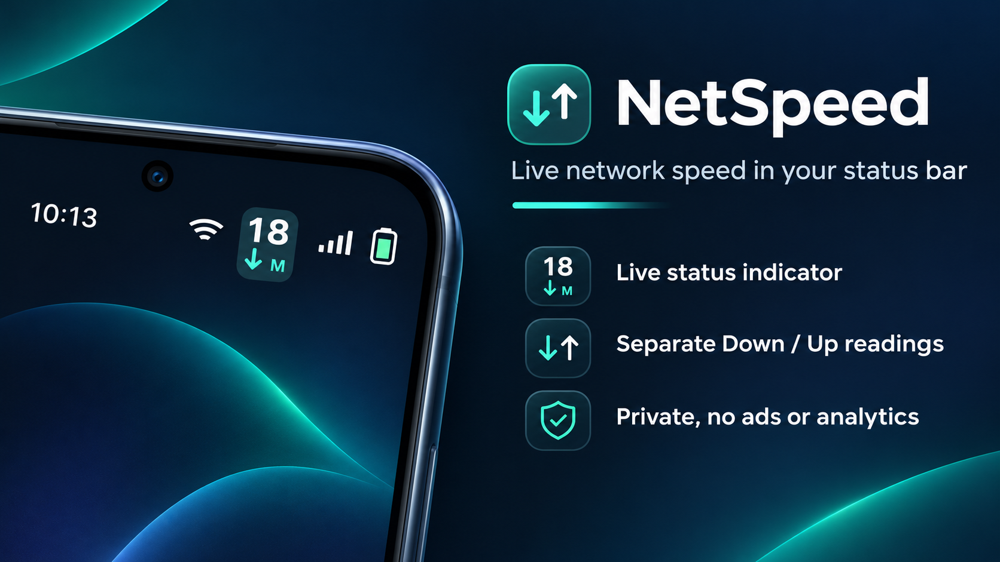
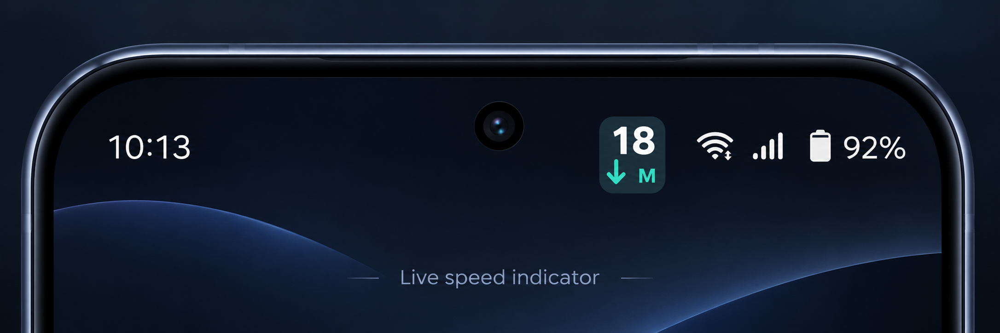

# NetSpeed

**A lightweight, privacy-friendly Android app that shows live network transfer speed in your status bar.**

[English](#english) · [العربية](#العربية)

[](https://github.com/Mohammad-Dawoud/NetSpeed/actions/workflows/build-apk.yml)


[](LICENSE)



> **Preview illustration / The final notification icon size and positioning depend on your Android device and One UI settings.  

---

## English

### Highlights

- **Live speed indicator:** a bold number in a compact status-bar notification icon, updated approximately once a second while awake.
- **Direction arrows:** ↓ when downloads dominate, ↑ when uploads dominate. The icon's number represents the **dominant direction**, not the sum.
- **Separate notification readings:** e.g. **Down: 18 Mb/s — Up: 110 Kb/s**, with automatic b/s, Kb/s and Mb/s units.
- **Simple controls:** start or stop monitoring from a single screen.
- **Private by design:** no root, account, ads, analytics, or server. No INTERNET permission.

### Notification preview



*Illustrative preview based on the tested design; real values change continuously.*

### Get NetSpeed

**Signed preview releases:** [GitHub Releases](https://github.com/Mohammad-Dawoud/NetSpeed/releases) — the first signed `v0.1.0` preview is **not published yet**. It will appear here after release-key setup and testing.

**Debug builds for testers:** [GitHub Actions](https://github.com/Mohammad-Dawoud/NetSpeed/actions/workflows/build-apk.yml) → successful build → **Artifacts** → `NetSpeed-debug` → extract `app-debug.apk`.

**Compatibility:** Android 12 (API 31) or newer. Tested during development on Samsung Galaxy S10 / Android 12 / One UI 4.1.

> Debug APKs from different build runners may have incompatible signing certificates. Moving to the first permanently signed release can require uninstalling an older debug build. Subsequent updates must use the same release signing key.

### How it works

NetSpeed uses Android's `TrafficStats` counters to estimate recent device-wide received/transmitted bits per second, divided by **actual elapsed sample time**. This reports recent transfer activity, **not** your connection's maximum internet speed. A foreground service keeps the indicator visible while started; Android may delay updates in sleep mode or restrict background work.

### Build and contribute

No Android Studio installation is required when using GitHub Actions. Developers with Java 17 and a compatible Android SDK can build locally:

```bash
./gradlew :app:testDebugUnitTest :app:assembleDebug
```

See [Contributing](CONTRIBUTING.md), [Changelog](CHANGELOG.md), and [Release guide](docs/RELEASING.md).

**License:** [MIT](LICENSE) © 2026 Mohammad Dawoud.

---

## العربية

### ما هو NetSpeed؟

تطبيق أندرويد صغير وخفيف يعرض سرعة استهلاك الإنترنت الحالية مباشرةً في شريط الحالة، دون الحاجة إلى فتح تطبيق منفصل أو تثبيت أدوات معقدة.

### أبرز المميزات

- **مراقبة مباشرة للسرعة:** رقم واضح داخل أيقونة شريط الحالة يُحدّث تقريبًا كل ثانية أثناء نشاط الجهاز.
- **توضيح اتجاه النقل:** السهم **↓** للتنزيل والسهم **↑** للرفع. الرقم في الأيقونة يمثّل سرعة الاتجاه الأعلى، وليس مجموع الاتجاهين.
- **فصل التنزيل والرفع:** إشعار يعرض السرعتين بصورة مستقلة مثل **Down: 18 Mb/s — Up: 110 Kb/s**، مع اختيار الوحدة المناسبة تلقائيًا.
- **واجهة بسيطة:** زرا Start وStop لتشغيل المراقبة وإيقافها.
- **احترام الخصوصية:** لا يحتاج إلى Root أو حساب أو خادم، ولا يجمع بيانات الاستخدام أو يطلب صلاحية الاتصال بالإنترنت.

### صور توضيحية

**عرض السرعة في شريط الحالة:**


**تفاصيل سرعتي التنزيل والرفع داخل الإشعار:**


*الصور توضيحية مستندة إلى شكل التطبيق الذي جرى اختباره، وقد يختلف العرض النهائي بحسب الهاتف.*

### التنزيل والتثبيت

ستُنشر ملفات APK الرسمية الموقّعة في صفحة [Releases](https://github.com/Mohammad-Dawoud/NetSpeed/releases) بعد إكمال إعداد التوقيع واختبار الإصدار الأول `v0.1.0`.

للتجربة حاليًا، افتح صفحة [GitHub Actions](https://github.com/Mohammad-Dawoud/NetSpeed/actions/workflows/build-apk.yml)، واختر عملية بناء ناجحة، ثم حمّل `NetSpeed-debug` من قسم Artifacts واستخرج ملف `app-debug.apk` وثبّته.

**متطلبات التشغيل:** Android 12 أو أحدث. جرى اختبار التطبيق أثناء التطوير على Samsung Galaxy S10 بنظام Android 12 وواجهة One UI 4.1.

**ملاحظة مهمة:** قد يتطلب الانتقال من نسخة Debug إلى النسخة الرسمية الموقّعة حذف النسخة القديمة إذا اختلف توقيعها الرقمي. وتستخدم الإصدارات الرسمية اللاحقة المفتاح نفسه للسماح بالتحديث.

### كيف يعمل؟

يقرأ التطبيق العدادات الإجمالية للبيانات المستقبلة والمرسلة من واجهة `TrafficStats` في أندرويد، ويحسب معدل النقل خلال الفترة الزمنية الفعلية بين القراءات. هذه السرعة تعبّر عن **حركة البيانات الحالية**، وليست اختبارًا للسرعة القصوى لاشتراك الإنترنت.

يعمل التطبيق بخدمة أمامية وإشعار مستمر، وقد يؤخر أندرويد التحديث عندما يكون الجهاز في وضع السكون أو عند فرض قيود البطارية.

### التطوير والمساهمة

المشروع مكتوب بلغة **Kotlin**، ويمكن بناء APK واختباره سحابيًا باستخدام **GitHub Actions** دون تثبيت Android Studio على حاسوبك.

للمزيد: [طريقة المساهمة](CONTRIBUTING.md) · [سجل التغييرات](CHANGELOG.md) · [دليل الإصدارات](docs/RELEASING.md)

**الترخيص:** [MIT](LICENSE) — حقوق النشر © 2026 Mohammad Dawoud.

---

**NetSpeed — One simple job, done well. | وظيفة واحدة، بأبسط شكل ممكن.**
